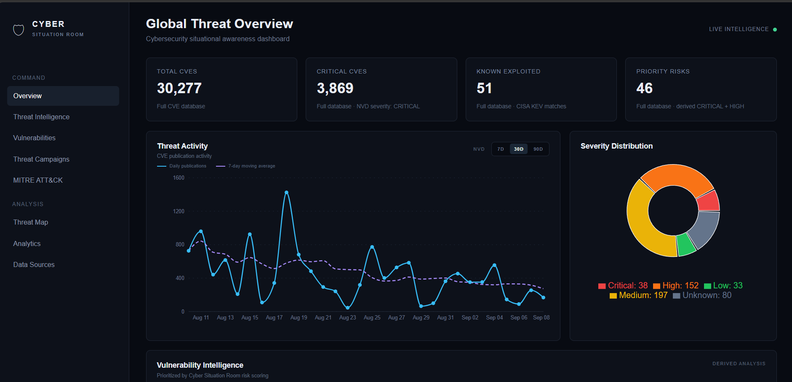
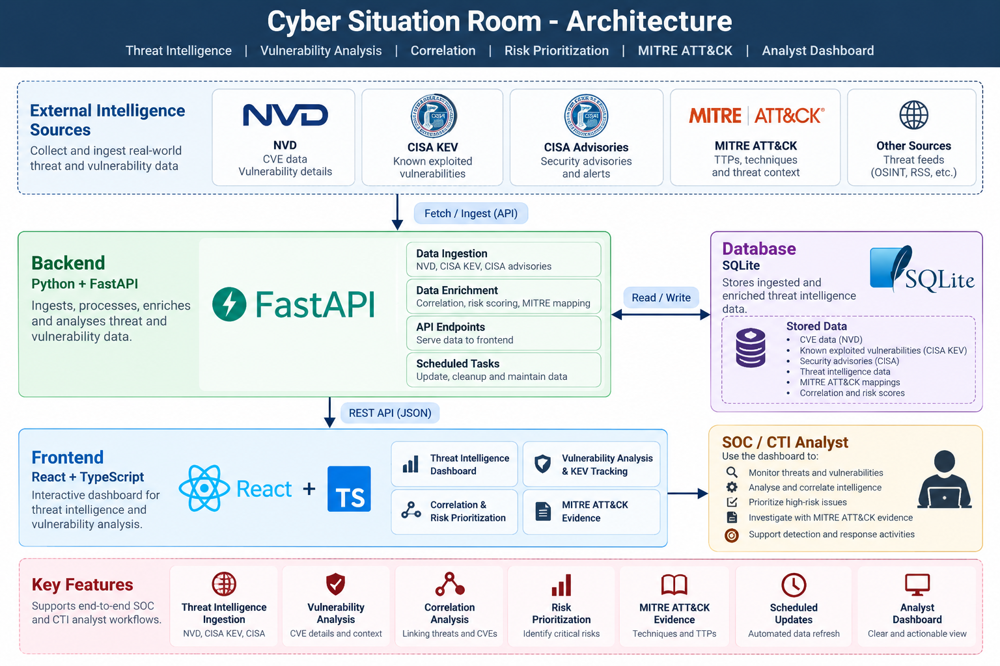

# Cyber Situation Room

A cybersecurity threat intelligence and vulnerability analysis platform designed to support SOC and CTI analyst workflows.

## Dashboard



## Architecture



## Overview

Cyber Situation Room combines threat intelligence, vulnerability intelligence, CISA advisories, NVD CVEs, CISA KEV data, correlation analysis, risk scoring, and MITRE ATT&CK evidence into an analyst-focused dashboard.

## Core Capabilities

- Threat Intelligence feed and filtering
- CISA advisory intelligence
- NVD vulnerability intelligence
- CISA KEV enrichment
- CVE correlation and relationship analysis
- Vulnerability prioritization
- CVSS and risk analysis
- Vulnerability timelines
- MITRE ATT&CK technique mapping
- Evidence-driven analyst workflow
- Security data visualization

## Analyst Workflow

Threat Intelligence -> CISA Advisory -> CVE Correlation -> NVD + CISA KEV -> Risk Analysis -> MITRE ATT&CK Evidence -> Analyst Investigation

## Technology Stack

### Frontend
- React
- TypeScript
- Vite
- Recharts
- TanStack React Query

### Backend
- Python
- FastAPI
- SQLAlchemy
- Uvicorn
- SQLite

### Intelligence Sources
- NVD
- CISA Known Exploited Vulnerabilities Catalog
- CISA threat and advisory intelligence
- MITRE ATT&CK

## API Endpoints

All endpoints are read-only `GET` requests. Full interactive documentation is served at `/docs` when the API is running.

```
GET /health
GET /cves?limit=500
GET /vulnerabilities/prioritized?limit=10
GET /vulnerabilities/risk-summary
GET /vulnerabilities/timeline?days=30
GET /vulnerabilities/risk-debug/{cve_id}
GET /threat-intelligence?limit=30
GET /threat-intelligence/summary
GET /threat-intelligence/{event_id}/correlations
GET /threat-intelligence/{event_id}/mitre-attack
GET /intelligence-analysis
GET /mitre-attack/analysis
GET /correlations/graph?limit=12
```

## Project Structure

```
cyber-situation-room/
  backend/
    main.py                  FastAPI app and all API routes
    database.py              SQLAlchemy engine (DATABASE_URL overridable)
    models.py                CVE, ThreatEvent, Source, AttackTechnique tables
    ingest_cves.py           NVD CVE ingestion
    enrich_kev.py            CISA KEV enrichment
    ingest_cisa.py           CISA advisory ingestion
    ingest_attack.py         MITRE ATT&CK Enterprise ingestion
    cleanup_old_cves.py      Optional: deletes CVEs not published in 2026
    requirements.txt
    requirements-dev.txt     Test dependencies
    tests/                   pytest API test suite
  frontend/
    src/
      main.tsx               Entry point and React Query client
      App.tsx                Page layout
      api.ts, config.ts      API base URL and fetch helper
      types.ts               API response types
      hooks/useDashboard.ts  Server data (React Query), UI state, handlers
      components/            One component per dashboard section
      lib/                   Formatting, data shaping, status labels
      index.css
  README.md
```

## Getting Started

Tested with Python 3.12 and 3.14, and Node.js 22 and 24. Other versions may work but have not been checked.

### 1. Clone the repository

```bash
git clone https://github.com/miersha29-a11y/cyber-situation-room.git
cd cyber-situation-room
```

### 2. Set up the backend

Windows (PowerShell):

```powershell
cd backend
python -m venv .venv
.\.venv\Scripts\Activate.ps1
pip install -r requirements.txt
```

macOS / Linux:

```bash
cd backend
python3 -m venv .venv
source .venv/bin/activate
pip install -r requirements.txt
```

If PowerShell blocks `Activate.ps1`, run `Set-ExecutionPolicy -Scope CurrentUser RemoteSigned` once, or call `.\.venv\Scripts\python.exe` directly.

### 3. Load the intelligence data

The SQLite database is not committed to the repository, so the dashboard is empty until these scripts are run. Run them from the `backend` folder with the virtual environment active, in this order:

```bash
python ingest_cves.py      # NVD CVEs published in the last 90 days
python enrich_kev.py       # flags CVEs listed in the CISA KEV catalogue (needs step 1 first)
python ingest_cisa.py      # CISA advisories and threat events
python ingest_attack.py    # MITRE ATT&CK Enterprise techniques
```

`enrich_kev.py` updates CVE records that already exist, so it must run after `ingest_cves.py`. The NVD script pauses between requests because NVD rate-limits clients without an API key, so it is the slowest step.

`cleanup_old_cves.py` is optional. It deletes every CVE not published in 2026, so do not run it unless that is what you want.

Re-run the ingest scripts whenever you want fresher data.

### 4. Start the API

```bash
uvicorn main:app --host 127.0.0.1 --port 8000
```

Check it is up at http://127.0.0.1:8000/health. Interactive API docs are at http://127.0.0.1:8000/docs.

### 5. Start the frontend

In a second terminal:

```bash
cd frontend
npm ci
npm run dev
```

The frontend calls the API at `http://127.0.0.1:8000` by default. To point it somewhere else, copy `frontend/.env.example` to `frontend/.env` and change `VITE_API_BASE_URL`.

Open http://localhost:5173. The API only accepts browser requests from this origin (see CORS settings in `backend/main.py`).

### Running the tests

From the `backend` folder with the virtual environment active:

```bash
pip install -r requirements-dev.txt
python -m pytest
```

The suite runs against a temporary database and never touches `cyber_situation_room.db`. It covers every route on an empty and a seeded database, risk scoring and prioritisation, advisory-to-CVE correlation, ATT&CK mapping, 404s for unknown records, rejection of malformed input, limit clamping, and the CORS policy.

### Production build

```bash
cd frontend
npm run build
```

The output is written to `frontend/dist/`.

## Validation

Checked against a fresh clone (Python 3.12, Node.js 22):

- `python -m pytest` passes: 46 automated API tests (see "Running the tests").
- `npm run build` and `npm run lint` complete with no errors.
- `npm audit --omit=dev` and `pip-audit` reported no known vulnerabilities at the time of checking.
- The dashboard was exercised in headless Chromium in three states: API stopped (error banner and red status indicators), API running with an empty database (ingest prompt and amber indicators), and API running with sample data (KPIs, charts, 7/30/90-day range switching, and the CVE and advisory detail panels all load with no console errors).

Not yet covered: there are no automated frontend tests, and live ingestion from NVD and CISA depends on those services being reachable.

## Security Focus

Cyber Threat Intelligence | Security Operations | Vulnerability Management | Threat Correlation | Security Analytics | MITRE ATT&CK

## Project Status

Functionally verified and prepared as a cybersecurity portfolio project.
